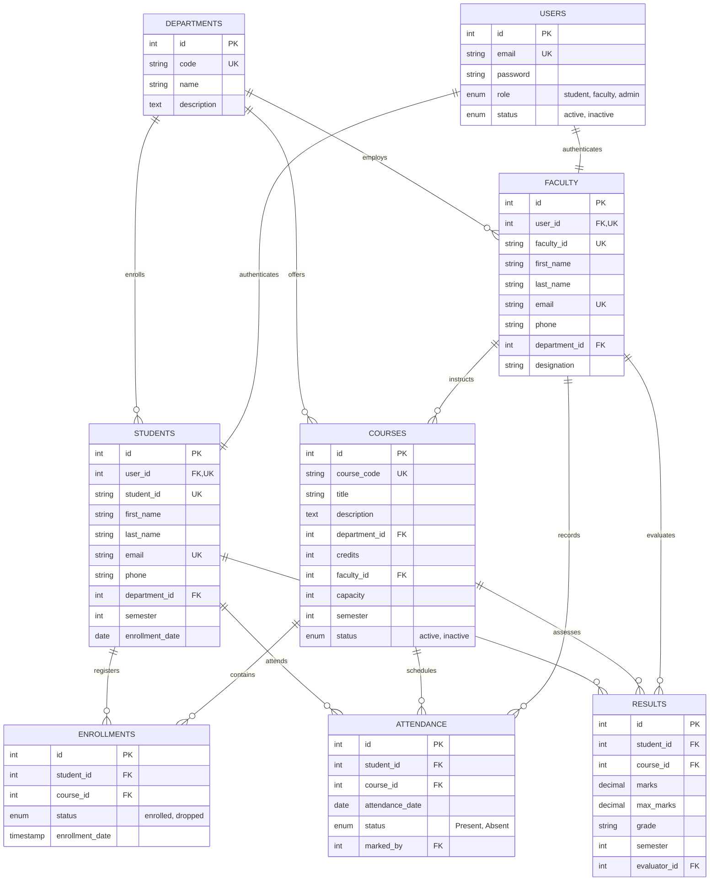

# College Management Portal - Normalized Database Schema

This document details the relational database design implemented in MySQL 8.4 for the College Management Portal MVP.

## 1. Schema Overview

The database uses **InnoDB** storage engine to support ACID transactions, row-level locking (`FOR UPDATE`), and foreign key constraints. UTF-8 character encoding (`utf8mb4_unicode_ci`) is enforced across all tables.

### Entity-Relationship Diagram

---

## 2. Table Specifications

### A. `departments`
Stores academic departments.
| Column | Type | Constraints | Description |
|---|---|---|---|
| `id` | INT | PRIMARY KEY, AUTO_INCREMENT | Department surrogate ID |
| `code` | VARCHAR(20) | UNIQUE, NOT NULL, CHECK (CHAR_LENGTH(code) >= 2) | Short code (e.g., 'CS', 'ECE', 'ME') |
| `name` | VARCHAR(100) | NOT NULL | Department official name |
| `description` | TEXT | NULL | Department overview |
| `created_at` | TIMESTAMP | DEFAULT CURRENT_TIMESTAMP | Record creation timestamp |

### B. `users`
Central credentials and RBAC authentication table.
| Column | Type | Constraints | Description |
|---|---|---|---|
| `id` | INT | PRIMARY KEY, AUTO_INCREMENT | User account ID |
| `email` | VARCHAR(191) | UNIQUE, NOT NULL | Login email (case-insensitive) |
| `password` | VARCHAR(255) | NOT NULL | Bcrypt hashed password |
| `role` | ENUM | 'student', 'faculty', 'admin', NOT NULL | Role-based authorization |
| `status` | ENUM | 'active', 'inactive', DEFAULT 'active' | Account suspension flag |
| `created_at` | TIMESTAMP | DEFAULT CURRENT_TIMESTAMP | Account registration date |
| `updated_at` | TIMESTAMP | ON UPDATE CURRENT_TIMESTAMP | Last profile update |

### C. `students`
Student demographic and academic records.
| Column | Type | Constraints | Description |
|---|---|---|---|
| `id` | INT | PRIMARY KEY, AUTO_INCREMENT | Student profile ID |
| `user_id` | INT | UNIQUE, NOT NULL, FK -> `users(id)` ON DELETE CASCADE | Associated login account |
| `student_id` | VARCHAR(50) | UNIQUE, NOT NULL | Institutional ID (e.g., 'STU-2024-001') |
| `first_name` | VARCHAR(50) | NOT NULL | Given name |
| `last_name` | VARCHAR(50) | NOT NULL | Family name |
| `email` | VARCHAR(191) | UNIQUE, NOT NULL | Institutional email address |
| `phone` | VARCHAR(20) | NULL | Contact telephone |
| `department_id` | INT | NOT NULL, FK -> `departments(id)` ON DELETE RESTRICT | Enrolled major |
| `semester` | INT | DEFAULT 1, NOT NULL, CHECK (semester BETWEEN 1 AND 8) | Current academic semester (1-8) |
| `enrollment_date` | DATE | DEFAULT (CURRENT_DATE) | Matriculation date |

### D. `faculty`
Faculty instructors and designations.
| Column | Type | Constraints | Description |
|---|---|---|---|
| `id` | INT | PRIMARY KEY, AUTO_INCREMENT | Faculty profile ID |
| `user_id` | INT | UNIQUE, NOT NULL, FK -> `users(id)` ON DELETE CASCADE | Associated login account |
| `faculty_id` | VARCHAR(50) | UNIQUE, NOT NULL | Institutional ID (e.g., 'FAC-2024-001') |
| `first_name` | VARCHAR(50) | NOT NULL | Given name |
| `last_name` | VARCHAR(50) | NOT NULL | Family name |
| `email` | VARCHAR(191) | UNIQUE, NOT NULL | Institutional email address |
| `phone` | VARCHAR(20) | NULL | Contact telephone |
| `department_id` | INT | NOT NULL, FK -> `departments(id)` ON DELETE RESTRICT | Appointed department |
| `designation` | VARCHAR(50) | DEFAULT 'Assistant Professor' | Academic rank |

### E. `courses`
Curriculum modules and registration capacity.
| Column | Type | Constraints | Description |
|---|---|---|---|
| `id` | INT | PRIMARY KEY, AUTO_INCREMENT | Course internal ID |
| `course_code` | VARCHAR(30) | UNIQUE, NOT NULL | Course code (e.g. 'CS101', 'CS201') |
| `title` | VARCHAR(150) | NOT NULL | Course title |
| `description` | TEXT | NULL | Syllabus and overview |
| `department_id` | INT | NOT NULL, FK -> `departments(id)` ON DELETE RESTRICT | Offering department |
| `credits` | INT | DEFAULT 3, NOT NULL, CHECK (credits BETWEEN 1 AND 10) | Credit weighting (1-10) |
| `faculty_id` | INT | NULL, FK -> `faculty(id)` ON DELETE SET NULL | Assigned instructor |
| `capacity` | INT | DEFAULT 30, NOT NULL, CHECK (capacity > 0) | Maximum student capacity |
| `semester` | INT | DEFAULT 1, NOT NULL, CHECK (semester BETWEEN 1 AND 8) | Target semester |
| `status` | ENUM | 'active', 'inactive', DEFAULT 'active' | Registration availability |

### F. `enrollments`
Student course registrations.
| Column | Type | Constraints | Description |
|---|---|---|---|
| `id` | INT | PRIMARY KEY, AUTO_INCREMENT | Enrollment record ID |
| `student_id` | INT | NOT NULL, FK -> `students(id)` ON DELETE CASCADE | Enrolled student |
| `course_id` | INT | NOT NULL, FK -> `courses(id)` ON DELETE CASCADE | Registered course |
| `enrollment_date` | TIMESTAMP | DEFAULT CURRENT_TIMESTAMP | Registration timestamp |
| `status` | ENUM | 'enrolled', 'dropped', DEFAULT 'enrolled' | Enrollment state |
| **Unique Constraint** | `uk_student_course` | `UNIQUE(student_id, course_id)` | Prevents duplicate student registrations |

### G. `attendance`
Session-by-session class attendance.
| Column | Type | Constraints | Description |
|---|---|---|---|
| `id` | INT | PRIMARY KEY, AUTO_INCREMENT | Attendance record ID |
| `student_id` | INT | NOT NULL, FK -> `students(id)` ON DELETE CASCADE | Evaluated student |
| `course_id` | INT | NOT NULL, FK -> `courses(id)` ON DELETE CASCADE | Course meeting |
| `attendance_date` | DATE | NOT NULL | Date of session (YYYY-MM-DD) |
| `status` | ENUM | 'Present', 'Absent', NOT NULL | Attendance status |
| `marked_by` | INT | NOT NULL, FK -> `faculty(id)` ON DELETE RESTRICT | Instructor recording attendance |
| **Unique Constraint** | `uk_student_course_date` | `UNIQUE(student_id, course_id, attendance_date)` | Enforces zero duplicate session records |

### H. `results`
Examination marks and calculated grades.
| Column | Type | Constraints | Description |
|---|---|---|---|
| `id` | INT | PRIMARY KEY, AUTO_INCREMENT | Result record ID |
| `student_id` | INT | NOT NULL, FK -> `students(id)` ON DELETE CASCADE | Exam candidate |
| `course_id` | INT | NOT NULL, FK -> `courses(id)` ON DELETE CASCADE | Evaluated course |
| `marks` | DECIMAL(5,2) | NOT NULL, CHECK (marks >= 0.00 AND marks <= max_marks) | Obtained marks (0.00 - max_marks) |
| `max_marks` | DECIMAL(5,2) | DEFAULT 100.00, NOT NULL, CHECK (max_marks > 0.00) | Total possible marks |
| `grade` | VARCHAR(5) | NOT NULL | Letter grade (A+, A, B, C, D, F) |
| `semester` | INT | DEFAULT 1, NOT NULL, CHECK (semester BETWEEN 1 AND 8) | Exam semester |
| `evaluator_id` | INT | NOT NULL, FK -> `faculty(id)` ON DELETE RESTRICT | Instructor entering grade |
| **Unique Constraint** | `uk_student_course_sem` | `UNIQUE(student_id, course_id, semester)` | One result per student/course/semester |

---

## 3. Concurrency & Integrity Mechanics

### Course Registration Concurrency Control
Course enrollment handles concurrent submissions safely using **MySQL transactions (`START TRANSACTION`)** and **exclusive row locking (`FOR UPDATE`)**:

1. A transaction begins on a dedicated connection.
2. The target course row is locked via `SELECT ... FOR UPDATE`, ensuring no concurrent modification can alter capacity.
3. Active enrollments are counted with `SELECT COUNT(*) ... FOR UPDATE`.
4. If `activeCount >= capacity`, the transaction rolls back immediately with HTTP 400.
5. If the student already holds an active enrollment row, the transaction rolls back with HTTP 409.
6. The enrollment row is inserted/activated, and the transaction commits atomically.

